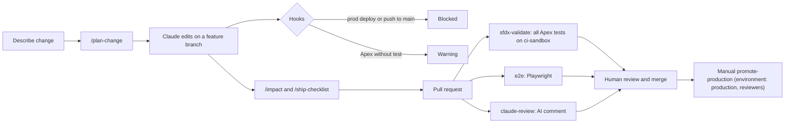

# claude-code-salesforce-pipeline

A safe cross-system development pipeline driven by Claude Code, shown on a small Salesforce onboarding example.

**This is a reference implementation, no client or employer code.** It is a personal project built to show the patterns. Nothing here was deployed to a real Salesforce org.

## The story

A customer fills a 3-step onboarding form (company details, owner details, product choice). The submission creates a `Customer_Onboarding__c` record. A legacy integration creates the same record without the form.

A validation rule change required a new field, `Tax_Id__c`. It was tested for the form but not for the legacy path, so legacy records started failing. The fix scopes the rule to non-legacy sources. A regression test and pipeline checks now cover the old path. Read the blameless write-up: [docs/INCIDENT-validation-rule-regression.md](docs/INCIDENT-validation-rule-regression.md).

## Pipeline



## What each file shows

| Path | What it shows |
| --- | --- |
| [CLAUDE.md](CLAUDE.md) | Project rules, architecture map, what Claude must never do |
| [.claude/hooks/guard-production.mjs](.claude/hooks/guard-production.mjs) | Hook that blocks prod deploys and pushes to main |
| [.claude/hooks/warn-apex-tests.mjs](.claude/hooks/warn-apex-tests.mjs) | Hook that warns when Apex changes without its test |
| [.claude/settings.json](.claude/settings.json) | Hook registration and a deny rule on workflow edits |
| [.claude/commands/](.claude/commands/) | `/plan-change`, `/impact`, `/ship-checklist` |
| [.claude/agents/](.claude/agents/) | Product subagents and the `build-*` agents that built this repo |
| [.mcp.json](.mcp.json) | Salesforce DX and Playwright MCP servers, no inline secrets |
| [tools/test-hooks.mjs](tools/test-hooks.mjs) | Proves the hooks block and warn as intended |
| [.github/workflows/claude-review.yml](.github/workflows/claude-review.yml) | Headless Claude review on pull requests, skips cleanly without the secret |
| [force-app/](force-app/) | Object, fields, `Require_Tax_Id`, Flow `Onboarding_Assign_Owner`, Apex and tests |
| [.github/workflows/sfdx-validate.yml](.github/workflows/sfdx-validate.yml) | Validate deploy with all Apex tests as a gate, plus manual production promotion |
| [docs/branch-protection.md](docs/branch-protection.md), [scripts/apply-branch-protection.sh](scripts/apply-branch-protection.sh) | Branch protection settings and a script to apply them |
| [demo-app/](demo-app/), [e2e/](e2e/) | Demo form and API, and Playwright tests with setup and teardown |
| [.github/workflows/e2e.yml](.github/workflows/e2e.yml) | Runs the Playwright tests in CI |
| [docs/RUNBOOK-making-a-change.md](docs/RUNBOOK-making-a-change.md) | Plain-language guide for non-developers |
| [docs/RECORDING-SCRIPT.md](docs/RECORDING-SCRIPT.md) | Script for recording a live walkthrough |
| [docs/verification.md](docs/verification.md), [docs/verification-e2e.md](docs/verification-e2e.md) | What was actually run here |

## Quick start

```
npm install
npx playwright install chromium
npm test                    # Playwright end-to-end tests
node tools/test-hooks.mjs   # hook tests
```

The Salesforce parts need the Salesforce CLI and an org, see below.

## Verified here vs not verified

Verified on one Windows 11 machine with Node 24 (details in [docs/verification.md](docs/verification.md)):
- Hook tests pass (`node tools/test-hooks.mjs`, 26 cases, including known bypass attempts).
- Playwright tests pass (`npm test`, 5 tests).
- All workflow YAML parses. All XML under `force-app` is well formed.

Not verified:
- Apex was never compiled. Test results and the 85 percent coverage target are by design only, not measured.
- Nothing was deployed. No Salesforce org was reachable and the `sf` CLI was not installed.
- No GitHub Actions workflow has run. The `sf` command flags, API version 65.0 and action versions were not tested in CI.
- The hooks were tested by piping JSON, not inside a live Claude Code session.
- The Flow is well formed XML only. Its schema validity was not checked.
- The guard hook is a safety net, not a security boundary. It splits commands naively, so it does not catch a deploy that relies on a default org of `prod`, a bare `git push` made while on `main`, or shell variables and subshells.
- A green `validate` check with no `SFDX_AUTH_URL` secret only means the XML parsed. The log says org validation was skipped.
- The e2e tests run against the JavaScript demo app, not against the Salesforce rule. Only the Apex tests cover `Require_Tax_Id`, and they have never run.
- The deny rule in `.claude/settings.json` blocks the Edit and Write tools only. Shell commands can still change workflows, so branch protection is the real guard.

## What you must configure

- Repo secrets `ANTHROPIC_API_KEY` and `SFDX_AUTH_URL`. Without them the review and org validation steps skip with a notice.
- GitHub environment `production`: add required reviewers and keep the production `SFDX_AUTH_URL` there.
- Branch protection on `main`: see [docs/branch-protection.md](docs/branch-protection.md).

## License

MIT, see [LICENSE](LICENSE).

Pipeline test.
